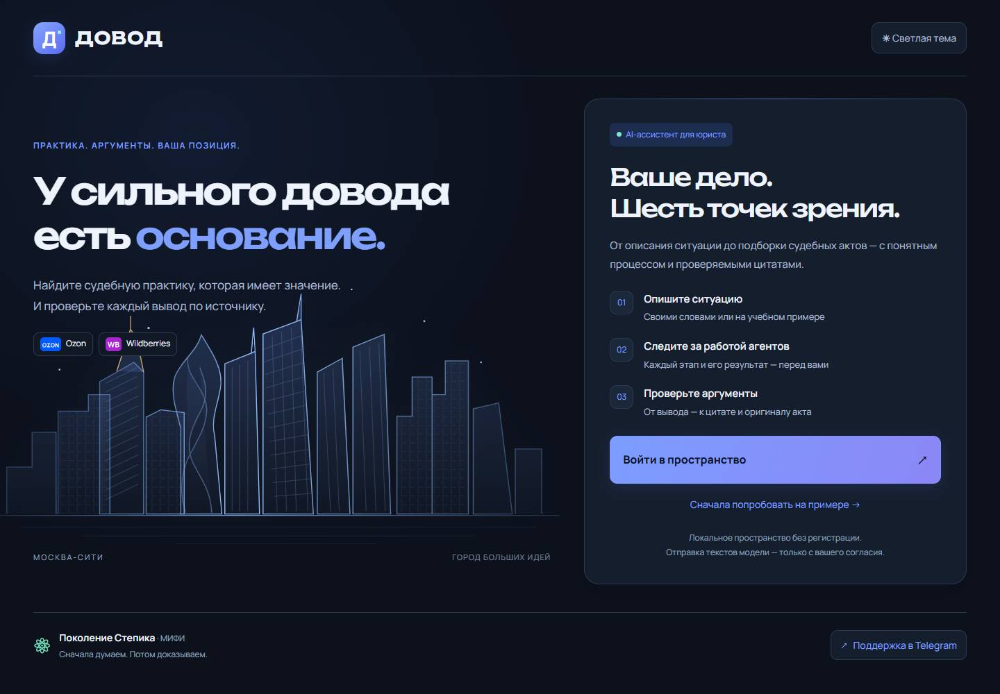
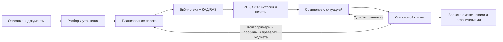

# Довод

**Команда: «Поколение Степика».**

**Задача:** мультиагентная система поиска и анализа арбитражной практики по спорам
о копировании фотографий, инфографики и текстов карточек товаров на Ozon и Wildberries.

**Участники:** Зиновьева Екатерина, Петухов Михаил, Грицких Артур, Педорин Илья,
Фролова Софья.

Версия 0.6 · 10 ноября 2026. Техническое имя репозитория — LexAgent.



## 1. Описание решения

Довод помогает юристу перейти от описания спора к подборке актов, существенным
совпадениям и отличиям, цитатам и предварительной исследовательской записке.
Каждый вывод можно проследить до доказательства, страницы и оригинала PDF.
Процент вероятности выигрыша не рассчитывается; итоговую оценку делает юрист.

Реализованы:

- Разбор ситуации, выявление пробелов и противоречий, уточняющие вопросы.
- Поиск в локальной библиотеке и внешних источниках, объединение и ранжирование выдач.
- Загрузка карточек КАД, поиск по текстам в Банке решений, история опубликованных актов.
- Постоянное хранение PDF по SHA-256, дедупликация и версии документов; OCR rus/eng.
- Исследователь, сопоставитель, смысловой критик, ограниченный поиск противоположной
  практики, дополнительное исследование и одно повторное сравнение.
- История исследований, остановка и продолжение, версии исходных сведений,
  журнал действий, цитаты, JSON-экспорт и печать.
- Тёмная и светлая темы, мобильный интерфейс, локальные шрифты и значки площадок;
  отдельные состояния подключения модели, источников и OCR.

Без ключей доступна локальная демонстрация. Её правила не заменяют понимание
свободного текста моделью, а внешний поиск в деморежиме не выполняется.

## 2. Структура репозитория

| Путь | Назначение |
|---|---|
| `app/main.py` | FastAPI, конфигурация интерфейса, API исследований, библиотеки и подключений |
| `app/agent.py`, `app/worker.py`, `app/budget.py` | Разбор, очередь, контрольные точки и бюджеты |
| `app/pipeline.py`, `app/agents/` | Исследование, сравнение, критик и отчёт |
| `app/search_agent.py`, `app/research_service.py` | Планирование поиска, история и подготовка документов |
| `app/sources.py` | Parser API: КАД, Банк решений, повторы и кэш |
| `app/documents.py`, `app/pdf_processing.py`, `app/pdf_worker.py` | Архив оригиналов, PDF и отдельный процесс OCR |
| `app/contracts.py`, `app/materials.py` | Контракт 2.1 с поддержкой 2.0 и связанные материалы исследования |
| `app/db.py`, `app/postgres.py`, `app/library.py` | SQLite/PostgreSQL, очередь и индекс библиотеки |
| `app/static/` | HTML/CSS/JavaScript, локальные SVG и шрифты с лицензиями |
| `samples/` | Три синтетических сценария и описание стартового корпуса |
| `eval/critic/`, `eval/retrieval/` | Синтетические регрессии критика и предварительные задачи поиска |
| `scripts/` | Подготовка OCR/БД, демонстрации, оценки и живые проверки |
| `tests/` | Серверные, PostgreSQL, OCR и браузерные проверки |
| `docs/`, `reports/` | Архитектура, ТЗ, инструкции и исторические протоколы проверок |
| `.github/workflows/ci.yml` | Проверки Linux/PostgreSQL и Windows/Edge |
| `requirements.lock.txt`, `.env.example`, `run.ps1` | Закреплённые зависимости, шаблон настроек, запуск Windows |

Локальные `.env`, `.venv/` и `data/` исключены из Git. В `data/` находятся рабочая
база, оригиналы PDF, кэш и установленный OCR. Эти файлы не являются мусором:
резервируйте БД и `data/originals/` вместе. Исходные архивы участников и временные
файлы проверки не входят в приложение.

## 3. Используемые технологии

- **Python 3.10+**, FastAPI, Uvicorn, Pydantic; асинхронная оркестрация asyncio.
- **GigaChat-2-Pro** по умолчанию, LangChain-интеграция и инструментальные циклы;
  альтернативный адаптер Yandex AI Studio / Alice AI.
- **SQLite** для быстрого запуска; **PostgreSQL 17**, psycopg и русский полнотекстовый
  поиск для расширенной библиотеки. Резервный поиск — лексический.
- **HTTPX**, Parser API для судебных источников; pypdfium2/PDFium и
  **Tesseract 5.5.3** rus/eng на Windows. pypdf сохранён для совместимости проверок.
- **HTML, CSS, JavaScript** без сборки и клиентского фреймворка.
  Manrope для текста, Unbounded для крупных заголовков; локальные WOFF2, лицензии SIL OFL.
- **pytest, Playwright / Microsoft Edge, Ruff, Node.js test runner**, GitHub Actions.

Все точные версии Python-пакетов находятся в `requirements.lock.txt`.
Происхождение графики и шрифтов — [в описании ресурсов](app/static/ASSETS.md).

## 4. Данные

### Судебные источники и интеграция КАД

Приложение обращается к **Parser API**, который предоставляет доступ к КАД
(`arbitr_api`) и Банку решений (`ras_arbitr_api`). Это реализованная интеграция
через посредника, а не прямой официальный API суда и не браузерный обход сайта.
Нужен `PARSER_API_KEY` с доступом к соответствующим сервисам.

По номеру дела загружаются карточка КАД, документы инстанций и события.
Тематический поиск выполняется по текстам Банка решений с пагинацией. Для истории
дела объединяются опубликованные акты КАД/RAS. PDF поступает через API, проверяется,
сохраняется по SHA-256, разбирается постранично; страницы без текста распознаются OCR.
Сохраняются происхождение текста, пропуски, confidence OCR и необходимость сверки.

В интерфейсе: **«Подключения» → «Проверить источники»**. Для известного номера:
**«Библиотека актов» → «Получить акты из КАД»**. Текст акта также можно импортировать
вручную; он получает отметку непроверенного по оригиналу.

### Примеры и корпус

В `samples/` находятся синтетические сценарии, а не истории реальных клиентов.
Стартовый retrieval-набор содержит **40 гипотетических задач по трём историческим
актам**: 27 dev и 13 test. Все метки предварительные (`pending`), экспертная разметка
будет выполнена участником 5 позже. Старые тексты не объявляются подтверждёнными
оригиналами; их необходимо сверить и расширить пул независимыми делами.

Скрипт `build_case_corpus.py` получает реальные документы через настроенный API
и сохраняет их локально. Обработка включает нормализацию номера дела, объединение
URL/дубликатов по содержимому, выделение страниц, проверку дословных цитат и
разделение групп дел между dev/test. Обучение собственной модели не выполнялось.

[Инструкция проверяющему корпус](docs/participant-5-annotation-handoff.md).

## 5. Архитектура и подход



Роли работают через ограниченные инструменты и типизированные контракты.
Модель получает зарегистрированные ID материалов, не произвольный доступ к файлам
или сети. Дословность цитаты и соответствие номера дела проверяются сервером;
смысловую применимость оценивают модель и затем человек.

Внешние запросы повторяются только при временных сбоях. Кэш ответов живёт до суток,
архив оригиналов не имеет срока истечения. Бюджеты резервируются до действия и
сохраняются в контрольных точках; после остановки используются уже собранные материалы.
Отчёт хранит ограничения, незакрытые замечания и происхождение источников.

Настройки по умолчанию: до 40 сетевых обращений и 80 модельных вызовов на запуск,
до 8 первоначально загружаемых актов, 3 страниц тематической выдачи,
100 записей и 10 страниц поиска истории по делу. У критика — один поиск
контрпримеров и до двух дополнительных исследований. PDF: до 10 МБ и 150 страниц;
до 20 000 символов на страницу. Лимиты не означают гарантированную полноту.

[Подробности реализации](docs/research-critic-0.5.md),
[контракты](docs/integration-v2.md), [интерфейс](docs/dovod-interface.md).

## 6. Эксперименты и результаты

| Проверка / гипотеза | Результат и границы |
|---|---|
| Хранение, восстановление, API и инструменты агентов | Для технической основы 0.5: 177 тестов Linux/PostgreSQL и 169 Windows/Edge успешно; [прогон](https://github.com/mpetukhov2008/LexAgent/actions/runs/42701438126) |
| Реальный OCR русского скана | Обязательный тест в обоих CI jobs; синтетический PDF без текстового слоя распознан |
| Структурные ошибки цитирования и замечаний | 18 синтетических регрессий: dev 10 / test 8, precision и recall 1.0; это не оценка юридического смысла |
| Lexical против multi-query fusion | На предварительных метках обоих split P@5 = 0.2, R@20 = 1.0 для обоих методов; преимущество fusion не показано |
| Полный пайплайн против варианта без критика | Воспроизводимый инструмент подготовлен; живое сравнение не выполнено без ключей и подтверждённой разметки |
| Проверка зависимостей основы 0.5 | 62 зависимости, известных уязвимостей не найдено; это не гарантия отсутствия неизвестных проблем |

P@5 использует знаменатель 5. При одном положительном деле и пуле всего из трёх дел
эти показатели почти неинформативны и не доказывают качество юридического поиска.
Нужны больше независимых дел, экспертные метки и новые слепые test-задачи.
Времена и расход токенов записываются в JSON конкретного прогона; измерений задержки
живой полной системы сейчас нет. Процент юридической точности не заявляется.

Результаты текущего изменения интерфейса и проверки настроек —
[в отчёте 0.6](reports/interface-0.6-2026-11-10.md).

## 7. Запуск и воспроизведение

### Windows: быстрый старт

Нужны Python 3.10+ с pip; для браузерного теста — Microsoft Edge.
Откройте PowerShell в корне репозитория:

```powershell
python -m venv .venv
.\.venv\Scripts\python.exe -m pip install -r requirements.lock.txt
if (-not (Test-Path .env)) { Copy-Item .env.example .env }
.\scripts\setup_ocr.ps1
.\run.ps1
```

Откройте **http://127.0.0.1:8010/**. OCR можно установить позже: без него доступны
демонстрация и PDF с текстовым слоем. `run.ps1` обновляет зависимости, если lock-файл
изменился. Если запуск PowerShell-скриптов запрещён, сервер запускается напрямую:

```powershell
.\.venv\Scripts\python.exe -m uvicorn app.main:create_app --factory --host 127.0.0.1 --port 8010
```

Без `DATABASE_URL` используется SQLite в `data/prospects.sqlite3`.
Выберите учебный пример и локальный режим: модель и внешние источники не вызываются.

### Linux

```bash
python3 -m venv .venv
.venv/bin/python -m pip install -r requirements.lock.txt
sudo apt-get install tesseract-ocr tesseract-ocr-rus
[ -f .env ] || cp .env.example .env
.venv/bin/python -m uvicorn app.main:create_app --factory --host 127.0.0.1 --port 8010
```

### Ключи и необязательная БД

Заполните `.env` на компьютере и перезапустите приложение:

| Переменная | Назначение |
|---|---|
| `GIGACHAT_AUTH_KEY` | Ключ авторизации GigaChat |
| `GIGACHAT_SCOPE`, `GIGACHAT_MODEL` | Область доступа и модель, по умолчанию `GIGACHAT_API_PERS` / `GigaChat-2-Pro` |
| `PARSER_API_KEY` | Доступ к КАД и Банку решений через Parser API |
| `DATABASE_URL` | Необязательное подключение PostgreSQL; пустое значение оставляет SQLite |
| `ENABLE_TOOL_RESEARCH`, `ENABLE_SEMANTIC_CRITIC` | Исследователь и смысловой критик в GigaChat, по умолчанию `true` |
| `ENABLE_OCR`, `OCR_LANGUAGES`, `TESSERACT_CMD` | OCR, языки и путь к движку |
| `DOCUMENT_DIR` | Каталог оригиналов, по умолчанию `data/originals` |
| `ENABLE_YANDEX`, `YANDEX_API_KEY`, `YANDEX_FOLDER_ID`, `YANDEX_MODEL_URI` | Альтернативный адаптер Yandex |

Действующие ключи в доступной копии проекта не найдены. Они не поставляются
в репозитории; `.env.example` содержит только шаблон. Приватность репозитория не
делает ключи частью исходного кода. Интерфейс различает «ключ задан» и «доступ проверен».
Диагностика Parser использует два обращения; авторизация GigaChat ещё не проверяет
генерацию выбранной моделью. Облачная обработка требует согласия пользователя.

Проверка TLS включена; адаптер использует системные сертификаты и при наличии
`data/gigachat-ca.pem`. Для отдельного локального PostgreSQL 17 и подготовки
сертификата есть `scripts/setup_local.py`; он создаёт `data/pg` и изменяет локальный
`.env`. [Подробная инструкция](docs/participant-1-complete.md).

### Тесты и оценки

```powershell
.\.venv\Scripts\python.exe -m ruff check app tests scripts
.\.venv\Scripts\python.exe -m pytest -q -rs
node --test tests/ui_progress.test.cjs
.\.venv\Scripts\python.exe scripts/eval_critic.py --split dev --check --out reports/critic-eval-dev.json
.\.venv\Scripts\python.exe scripts/eval_critic.py --split test --check --out reports/critic-eval-test.json
.\.venv\Scripts\python.exe scripts/eval_retrieval.py --allow-draft --split test --out reports/retrieval-eval.json
```

Node.js нужен только для проверки состояний интерфейса. Без Edge исключите
`tests/test_ui.py` из pytest; PostgreSQL-тесты пропускаются без **явного**
`TEST_DATABASE_URL` отдельной тестовой БД. Рабочая `DATABASE_URL` автоматически
не используется. Полный PostgreSQL-набор и браузер проверяются в GitHub Actions.
Тесты используют заглушки внешних сервисов и не расходуют платные квоты.

Получение нового пула и живые варианты при настроенных ключах:

```powershell
.\.venv\Scripts\python.exe scripts/build_case_corpus.py --case А70-7129/2024 --limit 8
.\.venv\Scripts\python.exe scripts/eval_pipeline_variants.py --allow-draft --limit 1 --out data/eval/variants.json
```

Первый шаг расходует квоту Parser API, второй вызывает платные модельные варианты
на одном замороженном пуле. Для экспертных метрик сначала нужна ручная разметка:
без `--allow-draft` предварительный корпус отклоняется. Живые сквозные проверки —
`scripts/live_api_smoke.py` и `scripts/live_pipeline_smoke.py`; исторические отчёты
не подтверждают сегодняшнюю доступность сервисов.

## 8. Ограничения и развитие

- Экспертная юридическая разметка отложена; стартовые метки не считаются эталоном.
- Полнота внешней базы, точный объект отмены и юридическая окончательность требуют
  проверки. API даёт снимок доступных опубликованных материалов, кэш — до суток.
- OCR ошибается; confidence не является вероятностью юридической правильности.
  Бюджет ограничивает число прочитанных документов и страниц.
- Смысловой критик — модельная проверка. Совпадение цитаты с текстом не доказывает
  её применимость; итоговые выводы проверяет юрист.
- Нет embeddings/pgvector и обученной собственной модели. Следующие шаги —
  расширение корпуса, экспертные метки, честное сравнение поиска и моделей.
- Нужны действующие ключи и доступ к провайдерам. Живой прогон 0.6 пока не подтверждён.
- Приложение рассчитано на localhost. Многопользовательская авторизация и изоляция
  данных для публичного сервера не реализованы. `completed` означает окончание
  обработки, а не доказанную полноту исследования.

История интеграции участников 2 и 5 и состав использованных материалов:
[отчёт 0.5](reports/integration-2-5-2026-11-10.md).
