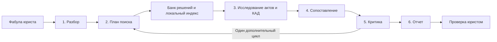

# Агентная система и реализация

Проектируем шесть агентов и обычный программный оркестратор. Агент имеет цель, ограниченные инструменты, возможность выбрать следующее действие и структурированный результат. Одна языковая модель может обслуживать все роли. OCR, скачивание и SQL сами по себе агентами не являются.

| Агент | Решение и инструменты | Результат | Владелец |
|---|---|---|---|
| 1. Разбор ситуации | Выделяет требования, подтвержденные факты и пробелы; читает документы, задает уточнения | Карточка спора, правовые вопросы, неизвестные данные | У1 |
| 2. Планировщик поиска | Выбирает формулировки и фильтры, расширяет слишком узкий запрос; вызывает поиск | План и журнал запросов, список кандидатов | У3 |
| 3. Исследователь дела | Выбирает содержательные акты, запрашивает текст и историю; проверяет последующие изменения | Карточка каждого дела, цитаты, статус проверки инстанций | У2 |
| 4. Сопоставитель | Сравнивает значимые факты и доказательства, отбрасывает формальные совпадения; читает дополнительные фрагменты | Рейтинг аналогов и объяснение различий | У4 |
| 5. Критик | Ищет противоположную практику, неподтвержденные выводы и противоречия; может вернуть задачу на поиск | Замечания, контрпримеры, решение о достаточности основания | У5 |
| 6. Составитель отчета | Выбирает допустимые выводы только из проверенных материалов; запрашивает проверку ссылок | Подборка, риски, недостающие доказательства, границы анализа | У4 |

Обязательное условие: каждый участник лично реализует хотя бы одного агента целиком — инструкции, инструменты, выбор действий, структурированный результат, обработку ошибок и проверочные сценарии. У1 владеет агентом 1, У2 — агентом 3, У3 — агентом 2, У4 — агентами 4 и 6, У5 — агентом 5. Общий SDK допустим; один промпт или интерфейс без агентной логики не засчитывается как реализация агента.

Дополнительно У1 реализует общее исполнение и ограничения; У5 — видимость этапов и оценку результата системы. Простой интерфейс собирается совместно: У1 — ввод и статус запуска, У4 — сравнение и отчет, У5 — цитаты и замечания критика. Это сохраняет время У5 на собственного агента. Оркестратор остается обычным кодом и не засчитывается У1 как агент.

## Поток

Оркестратор ограничивает число запросов, время и стоимость запуска. Начальные лимиты: до 6 формулировок запроса, до 100 уникальных кандидатов, глубокое чтение до 20 дел, не более одного дополнительного цикла. Лимиты предварительные и отображаются в отчете как ограничение охвата. При сбое источника запуск получает статус «частичный результат», а не «ничего не найдено».

## Поиск и оценка сходства

Для маркетплейсов карточка спора содержит: площадку; конкретный объект (фото, инфографика, текст, оформление); основание принадлежности прав; заявителя и предполагаемого нарушителя; способ появления контента; техническую возможность изменить карточку; дату нарушения и фиксации; версию правил площадки, если она значима; доказательства; требования и расчет компенсации. Неизвестные значения остаются неизвестными. Агент-критик отдельно ищет дела с иным способом размещения, недостаточными доказательствами и противоположным исходом. Подробная постановка — в [тематическом плане](marketplaces.md).

Для поступивших актов создаем индекс текста и смысловых представлений. Объединяем результаты поиска по словам и по смыслу, убираем дубликаты, затем сопоставляем кандидатов с фабулой. Поиск по смыслу работает по полученному корпусу, а не автоматически по всей КАД.

Оценка учитывает предмет требований, вид отношений, ключевые факты, доказательства, возражения, процессуальную стадию и применимую редакцию норм. Совпадение статьи или суммы недостаточно. Разницу между доводами стороны и установленными судом обстоятельствами храним явно. Итоговый балл сходства не означает вероятность победы.

Решения разных инстанций объединяются в одну карточку дела; несколько актов одного дела не считаются независимыми аналогами. Для банкротства в будущем потребуется выделять отдельные обособленные споры. Неизвестный статус обжалования помечается как неизвестный. Формулировка «не найден последующий акт» не заменяет подтвержденный статус.

## Данные и стек

Текущая реализация для предварительной защиты: `app/agent.py` — только агент 1, `app/worker.py` — оркестратор первого этапа, `app/db.py` — локальная SQLite. Остальные роли не имитируются. Дальнейший целевой стек ниже остается планом; PostgreSQL еще не подключен. О режимах Alice AI и demo см. [инструкцию участника 1](participant-1-defense.md).

Предлагаемый стек: Python/FastAPI, PostgreSQL, простой worker заданий, веб-интерфейс; PostgreSQL full-text и pgvector как кандидаты для индекса. Выбор библиотек и моделей фиксируется после первого эксперимента. Собственное обучение модели, отдельная инфраструктура микросервисов и сложные агентные протоколы не нужны для первой версии.

Объекты: `Matter` (запрос и факты), `SearchRun` (источники, запросы, лимиты), `Case`, `JudicialAct`, `Evidence`, `Comparison`, `Report`. У акта сохраняются URL, номер, суд, дата, инстанция, хеш файла, время получения, текст по страницам. У цитаты — ID акта, страница, точный фрагмент; у вывода — ссылки на цитаты и признак неопределенности.

Проверка цитат кодом устанавливает наличие текста; критик проверяет смысловую связь с выводом. Эти проверки дополняют друг друга. Содержание документов считается данными: команды из судебных актов или загруженных файлов не выполняются. Внешнему поиску передаем обезличенные формулировки; реальные клиентские материалы не отправляются внешней модели без согласованного режима обработки.
